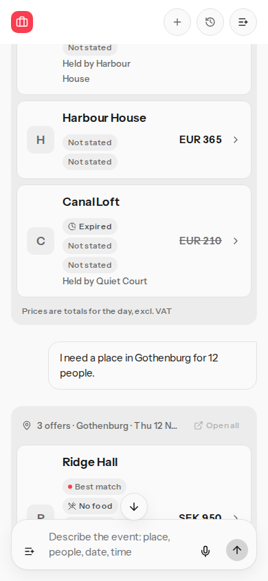
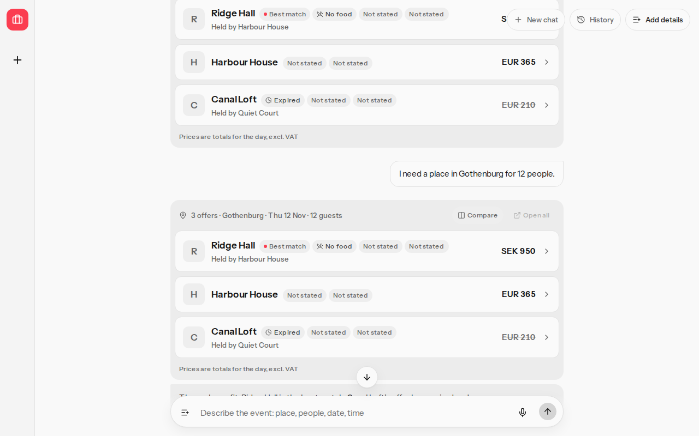
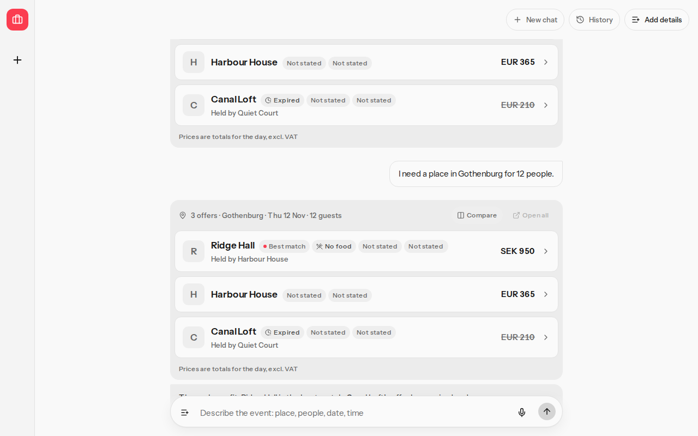

# Header buttons and a scrolled price

## Before

At 1280×800 the header sat over the thread. Scrolling the first of two result cards brought Ridge Hall's price under New chat. SEK 950 showed as S.

At 390×844 the header stays in the column above the thread. The same scroll leaves the header buttons clear of the prices.

## After

At 1280×800 the header sits above the thread. Harbour House shows EUR 365, Canal Loft shows EUR 210, and Ridge Hall shows SEK 950. The buttons do not cover the card.

At 390×844 the frame matches the earlier one. The header buttons stay clear of the prices.

## Check

`pnpm exec playwright test e2e/result-cards.spec.ts -g "keeps header buttons off a scrolled result card"` at 390×844 and 1280×800.
